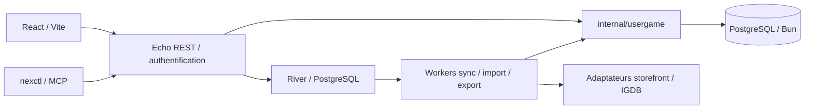

# RK Gaming Manager — audit et fondations

> Cet audit décrit la phase 1. La protection désormais implémentée dans les
> chemins historiques, ses migrations et limites sont décrites dans
> [Phase 2A](RK-PHASE-2A.md). Les mentions « lot suivant » ci-dessous
> appartiennent à l’état audité de la phase 1.

## Périmètre et état

Audit du fork `Reyk0San/RK-Gaming-Manager`, branche `develop`, commit
`8d8d52b402b69d56a18c23ea9f43c74f02e76528`. Phase 1 : conserver Nexorious,
préparer la progression multi-plateforme et un déploiement indépendant.
La licence MIT de Nexorious et ses mentions sont conservées. Aucun code
d’Achievist n’est utilisé ; sa licence reste à clarifier avant toute réutilisation.

Livré : cet audit, un contrat Go indépendant `progressadapter`, une sélection
de valeurs donnant priorité au manuel avec tests, et un exemple Compose isolé.
Le contrat n’est **pas branché aux workers**. Aucun nouveau connecteur, endpoint,
schéma actif, migration appliquée ou déploiement n’est introduit. Le module Go,
les binaires, les routes et l’interface existante gardent leurs noms Nexorious.

## Architecture existante



| Couche       | Sources auditées                                                           | Rôle                                                                        |
| ------------ | -------------------------------------------------------------------------- | --------------------------------------------------------------------------- |
| Serveur      | `cmd/nexorious`, `internal/api/router.go`                                  | Go 1.26.2, Echo v5, API REST, SPA embarquée                                 |
| Client       | `ui/frontend/package.json`, `src/routes`, `vite.config.ts`                 | React 19, Vite 8, TypeScript, TanStack Router/Query, Tailwind, Radix        |
| Domaine      | `internal/usergame`                                                        | Acquisitions, plateformes, statuts, progression, transactions et invariants |
| Persistance  | `internal/db/models`, `internal/db/migrations`                             | Bun, PostgreSQL, SQL embarqué et migration explicite                        |
| Travaux      | `internal/worker/tasks`, `internal/scheduler`                              | River, reprises, suivi des jobs et maintenance périodique                   |
| Sources      | `internal/services`                                                        | Métadonnées IGDB, matching, résolution de plateformes et synchronisation    |
| Exploitation | `Dockerfile`, `deploy/docker`, `internal/backup`, `internal/observability` | Image multi-stage, PostgreSQL 18, sauvegardes, métriques et traces          |

Le serveur bloque l’accès normal quand la DB est indisponible ou les migrations
sont nécessaires. Les workers démarrent après migration. La SPA est embarquée
par `ui/ui.go` ; il faut construire son `dist` avant une compilation complète.
`nexctl` fournit le client REST et le serveur MCP local, sans ajouter MCP au serveur.

### Modèles et migrations

`internal/db/models/models.go` contient notamment :

| Modèle / table                                     | Données actuelles                                                                                               |
| -------------------------------------------------- | --------------------------------------------------------------------------------------------------------------- |
| `Game` / `games`                                   | Catalogue IGDB partagé et métadonnées                                                                           |
| `UserGame` / `user_games`                          | Utilisateur, jeu, statut global, note, favoris, souhaits, notes personnelles                                    |
| `UserGamePlatform` / `user_game_platforms`         | Plateforme, boutique, propriété, disponibilité, heures, compteurs de succès, lien externe et `sync_from_source` |
| `ExternalGame` / `external_games`                  | Identité `(user_id, storefront, external_id)`, résolution IGDB, revue, métadonnées source                       |
| `ExternalGamePlatform` / `external_game_platforms` | Plateforme canonique, heures et compteurs observés                                                              |
| `UserSyncConfig` / `user_sync_configs`             | Paramètres et identifiants chiffrés par utilisateur/source                                                      |
| Autres                                             | Auth/session/API keys, tags, pools, jobs/items/changements, notifications, sauvegardes                          |

Les migrations Bun `*.up.sql` / `*.down.sql` sont découvertes par
`internal/db/migrations/migrations.go`. Le baseline est
`20260620000001_baseline`; les suivantes ajoutent notamment réglages utilisateur,
ignorances de contrôle de bibliothèque, boutiques et icônes. La migration
`20260622000002_add_achievement_counts` ajoute les compteurs aux deux tables de
plateformes. Aucun catalogue de succès individuels, session de jeu ou pourcentage
de progression par plateforme n’est présent dans ces modèles.

### Synchronisations et API

`storefrontadapter.Adapter.GetLibrary` produit des lots `ExternalGameEntry`.
`internal/worker/tasks/sync.go` conserve les jeux externes, canonicalise les
plateformes, fait le matching IGDB puis passe par `usergame.Acquire`.
La revue des correspondances et les jobs existants doivent être réutilisés.

| Source            | Présent dans le dépôt                                                                      | Extension prévue                                               |
| ----------------- | ------------------------------------------------------------------------------------------ | -------------------------------------------------------------- |
| Steam             | Bibliothèque, temps, compteurs de succès ; clients et tests                                | Détail des succès et observations datées                       |
| PlayStation       | `playstationstore`, NPSSO, bibliothèque et temps ; adaptateur ne fournit pas les compteurs | Trophées par jeu/plateforme, expiration et reprise d’auth      |
| Xbox              | Aucun adaptateur de synchronisation identifié                                              | Étude des accès autorisés et de l’auth avant développement     |
| RetroAchievements | Aucun adaptateur de synchronisation identifié                                              | Compte, identifiants de jeu, succès, points, softcore/hardcore |
| GOG, Epic, Humble | Adaptateurs de bibliothèque existants                                                      | Préserver sans imposer de nouvelles capacités                  |

Les routes existantes sont définies dans `internal/api/router.go` et les
`RegisterRoutes` des handlers : `/api/auth`, `/api/games`, `/api/user-games`
(plateformes, stats, progression), `/api/platforms`, `/api/tags`, `/api/pools`,
`/api/sync`, `/api/jobs`, `/api/job-items`, `/api/import`, `/api/export`,
`/api/settings`, `/api/notifications`, `/api/library/smells` et les routes admin
(utilisateurs, sauvegardes, événements). Migration/setup ont leurs propres gates.
Les nouvelles routes devront conserver l’auth et l’isolation par utilisateur.

## Risque prioritaire : provenance des saisies manuelles

**L’existant ne garantit pas une priorité absolue au manuel.** Dans
`internal/usergame/acquire.go`, `mergeOnePlatform` choisit le maximum des heures
existantes et importées et fait un `COALESCE` pour les compteurs de succès.
Une valeur manuelle inférieure peut donc changer lors d’une synchronisation.
`UpdatePlatform` ne change pas `sync_from_source`, qui indique une origine de
ligne et ne suffit pas à identifier les champs édités manuellement.
La promotion automatique du statut en fonction des heures doit aussi être revue
pour distinguer un statut explicite d’un statut calculé.

Cette phase ne modifie pas ces chemins historiques. **Avant de connecter le
nouveau contrat, il faut corriger cette limite**, migrer la provenance et tester
les workers existants : ne pas prétendre que le nouveau résolveur protège déjà
les synchronisations actuelles. Aucune valeur existante n’est réécrite par ce lot.

Règle cible : saisie manuelle conservée séparément, priorité champ par champ,
y compris `0`, suppression uniquement par action utilisateur explicite. Les
observations restent consultables même si elles sont masquées par un override.
Ne jamais additionner deux totaux fournisseurs ni convertir une absence en zéro.
Un jeu terminé manuellement ne doit pas être déclassé ; un pourcentage de succès
ne signifie pas automatiquement que l’histoire est terminée.

## Fondations techniques et modèle cible proposé

`internal/services/progressadapter` est une frontière optionnelle complémentaire
à la bibliothèque. `Adapter.Fetch` reçoit une référence compte/jeu/plateforme et
retourne un `Snapshot` daté. `Metrics` utilise des pointeurs pour distinguer
inconnu et zéro ; le temps canonique est un entier en secondes. `Resolve`
sélectionne les overrides manuels sans modifier les entrées. Aucun adaptateur
factice n’est enregistré. Le worker de persistance reste à développer.

Modèle relationnel proposé, **pas une migration exécutable** : UUID internes,
clés étrangères et transactions Bun ; garder les colonnes historiques comme
projection compatible pendant la transition.

| Table future                | Colonnes et contraintes principales                                                                                                                                          |
| --------------------------- | ---------------------------------------------------------------------------------------------------------------------------------------------------------------------------- |
| `platform_accounts`         | `id`, `user_id` FK, `provider`, `external_account_id`, `credentials_encrypted`, état auth, timestamps ; UNIQUE utilisateur/provider/compte externe                           |
| `platform_game_links`       | `id`, `account_id` FK, `user_game_platform_id` FK, `external_game_id`, identifiant de plateforme externe ; UNIQUE compte/jeu externe/plateforme ; matching explicite IGDB    |
| `progress_observations`     | `link_id` FK UNIQUE (dernier état), `observed_at`, `fetched_at`, secondes cumulées BIGINT nullable, succès débloqués/total nullable, pourcentage nullable, version source    |
| `progress_manual_overrides` | `user_game_platform_id` FK UNIQUE, mêmes métriques nullables, statut manuel de plateforme nullable, `updated_at`, version pour concurrence optimiste ; NULL = aucun override |
| `achievement_definitions`   | Identité provider/jeu externe/plateforme/set/mode/succès externe UNIQUE, titre, description, icône, points nullable ; conserver les groupes de trophées et les modes RA      |
| `account_achievements`      | `link_id` FK + `achievement_definition_id` FK UNIQUE, état nullable, `unlocked_at` nullable, `observed_at` ; heure de déblocage inconnue distincte d’un succès verrouillé    |
| `play_sessions` (ultérieur) | Plateforme utilisateur FK, début/fin, durée, origine manuelle/source, identifiant source UNIQUE par compte ; jamais inventées à partir d’un total cumulé                     |

CHECKs futurs : secondes/compteurs positifs ou nuls, pourcentage entre 0 et 100,
débloqués <= total lorsque tous deux connus. Valider aussi à la frontière Go.
Les liens doivent appartenir au même utilisateur : vérification transactionnelle
et contraintes composites ou mécanisme équivalent ; une FK UUID seule ne prouve
pas l’appartenance. Les succès doivent correspondre au jeu et au fournisseur du
lien. Les secrets et tokens ne doivent jamais apparaître dans les snapshots/API.

Un lien ne fusionne pas automatiquement PC/PS4/PS5, remasters ou éditions.
Plusieurs comptes restent séparés. Si plusieurs observations concernent une
plateforme utilisateur, sélectionner une source explicitement, sans somme.
Le taux de succès peut être calculé séparément lorsque total > 0 ; afficher
« inconnu » pour un total nul/inconnu, et distinguer cette mesure de la progression.

### Intégration et migration à réaliser dans le lot suivant

1. Ajouter les tables et leurs migrations up/down ; ne supprimer aucune colonne.
2. Copier les métriques externes vers les observations. Conserver toutes les
   valeurs utilisateur existantes comme overrides si leur provenance est ambiguë,
   même lorsque `sync_from_source=true`. Ne pas déduire la provenance d’un maximum.
3. Faire écrire chaque édition manuelle dans les overrides et chaque sync dans
   les observations ; centraliser les projections compatibles dans `usergame`.
   Verrouiller la ligne de plateforme pendant résolution/écriture ; une sync
   concurrente ne doit jamais écraser une édition. Lier les données par utilisateur.
4. Refuser les observations plus anciennes ; rendre les upserts idempotents.
   Ne pas effacer les données sur profil privé, timeout, pagination partielle ou
   déconnexion. Annulation, quotas, backoff et erreurs auth restent pilotés par River.
5. Ajouter lectures/provenance et édition d’overrides à l’API avec PATCH
   distinguant omission, valeur et effacement explicite. Étendre export/import et
   restauration avant activation. Ne pas exposer de nouveaux endpoints dans ce lot.
6. Tester migration aller/retour sur copie, sync répétée, zéro manuel, source
   absente, compte privé, ancien snapshot, deux utilisateurs et édition concurrente.
   Activer Steam seul après ces contrôles, puis PSN, Xbox et RA séparément.

## Interface responsive et PWA iPhone

La SPA possède déjà viewport, icône Apple et thème ; `vite.config.ts` ne configure
pas de PWA/service worker. Conserver les écrans et composants existants puis
ajouter la provenance (manuel/source/date), les métriques par plateforme et une
action explicite de retour à la valeur source.

Lot PWA prévu : manifeste avec icônes 192/512 et maskable, affichage standalone,
HTTPS, safe areas iOS, cibles tactiles d’au moins 44 px, formulaires sans zoom
involontaire, navigation utilisable dès 375 px, focus/clavier accessibles. Valider
sur Safari et depuis l’écran d’accueil iPhone, portrait et paysage. Prévoir un
shell hors ligne et un message clair quand les données nécessitent le réseau.
Ne pas mettre en cache les réponses auth, tokens ou données privées ; vider les
caches au logout/changement d’utilisateur. La sync reste côté serveur, sans
dépendance aux tâches de fond iOS. PWA et tests appareil restent à implémenter.

## Docker Compose, TrueNAS SCALE et Dockge

`deploy/docker/compose.rk.yml` est un exemple pour **une nouvelle stack** sur une
version de TrueNAS SCALE offrant Docker Compose, ou dans Dockge. Les anciennes
versions basées sur Kubernetes nécessitent une adaptation : aucune compatibilité
universelle n’est présumée. Aucun serveur TrueNAS n’a été contacté ou modifié.

Le nom de projet `rk-gaming-manager`, les volumes propres et le port hôte 8010
isolent cette stack. Ne pas réutiliser les volumes, le nom de projet, les chemins
ou la base de l’installation existante. PostgreSQL n’a pas de port hôte ; son
volume PostgreSQL 18 monte `/var/lib/postgresql`. L’app conserve son UID/GID 10001
et le tmpfs Legendary. En cas de bind mounts ZFS, prévoir des datasets neufs et
des ACL adaptées aux UID des images ; ne pas appliquer de changement récursif aux
datasets existants. Conserver la clé de chiffrement avec les sauvegardes hors DB.

Préparation future, après revue, sur une machine de build :

```sh
docker build --target runtime -t rk-gaming-manager:phase1 .
```

Ce tag est un exemple local, pas une image RK publiée. Pour Dockge/TrueNAS sur un
autre hôte, publier l’image dans un registre accessible et utiliser un digest
revu dans `RK_IMAGE`. Le Dockerfile existant construit la SPA et les deux binaires.

Copier le fichier Compose et `.env.rk.example` dans un nouveau dossier de stack,
nommer les copies `compose.yaml` et `.env`, remplacer les secrets et l’image.
Utiliser un mot de passe aléatoire et une clé distincte produite par
`openssl rand -base64 32`. Les variables `DB_*` évitent d’insérer le mot de passe
dans une URL. Les identifiants IGDB sont optionnels pour démarrer, nécessaires
aux fonctions d’enrichissement correspondantes.

Validation locale sans lancer de service : `docker compose config --quiet`.
Le lancement éventuel `docker compose up -d` doit se faire dans ce dossier neuf.
Ouvrir ensuite `/migrate` pour appliquer explicitement les migrations puis
effectuer le setup administrateur ; le conteneur ne migre pas automatiquement.
Le bind par défaut `127.0.0.1` attend un reverse proxy HTTPS sur l’hôte. Pour un
proxy sur une autre machine, sélectionner explicitement une adresse LAN et ses
règles d’accès ; les cookies Secure exigent HTTPS. Un proxy conteneurisé doit
avoir un accès réseau explicite à l’app, localhost désignant son propre conteneur.
Ne pas exposer PostgreSQL ni rendre les secrets dans des captures de configuration.

Prévoir sauvegardes applicatives et DB, copie externe et exercice de restauration
sur une stack jetable. Ne jamais employer `down -v` sur l’installation existante.
Cet exemple reste à valider sur TrueNAS/Dockge réels ; aucun déploiement n’a été fait.

## Plan de développement et critères de passage

| Lot              | Résultat attendu                                                                    | Validation avant activation                                                        |
| ---------------- | ----------------------------------------------------------------------------------- | ---------------------------------------------------------------------------------- |
| 1 — présent      | Audit, contrat de progression, priorité au manuel testée isolément, Compose proposé | Tests disponibles et limites consignées                                            |
| 2 — protection   | Provenance, tables additives, projections via `usergame`, import/export             | Tests PostgreSQL, migrations, sauvegardes et concurrence ; aucun manuel écrasé     |
| 3 — Steam        | Adaptation de la sync existante, succès détaillés                                   | Profil privé, quotas, idempotence, revue matching, compatibilité CLI/API           |
| 4 — PSN          | Extension trophées/plateformes du connecteur existant                               | Expiration NPSSO, erreurs API, séparation PS4/PS5                                  |
| 5 — Xbox puis RA | Connecteurs indépendants après étude API/licences                                   | Tests par fournisseur, multi-compte, RA hardcore/softcore                          |
| 6 — expérience   | Vues progression, responsive, PWA et packaging RK                                   | Safari/iPhone, accessibilité, non-régression et restauration Dockge/TrueNAS isolée |

Les fonctions catalogue, collection, tags, pools, import/export, sauvegardes,
auth, notifications, CLI/MCP et connecteurs actuels restent dans le périmètre de
non-régression. Ne pas renommer globalement le module ni réécrire le moteur de jobs.

## Vérification de cette phase

Résultats dans cet environnement :

- Frontend : 94 fichiers, 1 085 tests réussis (`npm test -- --maxWorkers=2`).
- `npm run build` réussit, contrôle TypeScript inclus ; avertissement de taille
  du bundle principal (environ 1 531 kB minifié).
- Nouveau package : 3 tests réussis avec `go test -race`.
- Compose : `config --quiet` réussit avec des variables de validation fictives.
- Suite Go complète : un échec, `internal/logging/TestRoundTripper_LogsTransportError`,
  « expected transport error ». Reproduit sur un worktree vierge de `develop`
  au commit audité. Ce test attend une erreur pour `nonexistent.invalid` ;
  le proxy de l’environnement semble renvoyer une réponse HTTP à la place.
  Les autres packages passent, dont API, migrations, usergame et workers.
- La première tentative Go était bloquée par le cache de modules en lecture seule
  et les sockets restreints ; la relance avec cache temporaire inscriptible et
  accès réseau a permis les tests PostgreSQL/Testcontainers locaux. Aucun accès
  à l’installation TrueNAS n’a eu lieu.

Les résultats sont également consignés dans la pull request. Commandes
de référence : `go test -timeout 600s ./...`, `npm test` dans `ui/frontend`,
`npm run build`, tests ciblés `go test ./internal/services/progressadapter` et
validation Compose. Les tests d’intégration Go utilisent PostgreSQL 18 via
Testcontainers et nécessitent un daemon Docker accessible. Une indisponibilité
de dépendances ou de Docker est un blocage de validation, pas un test réussi.
